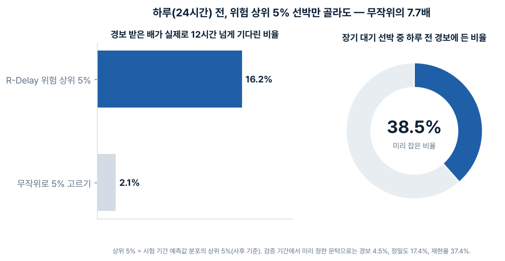
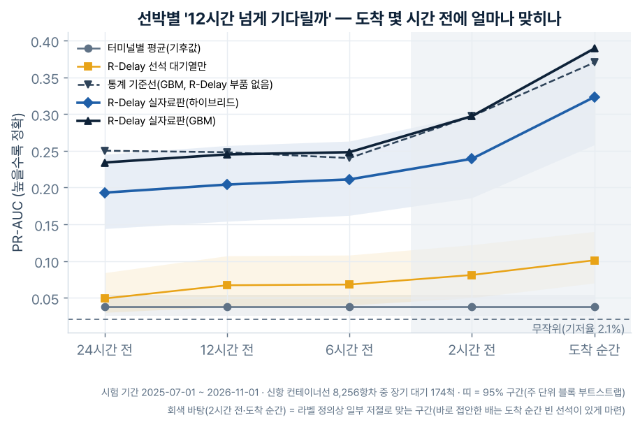
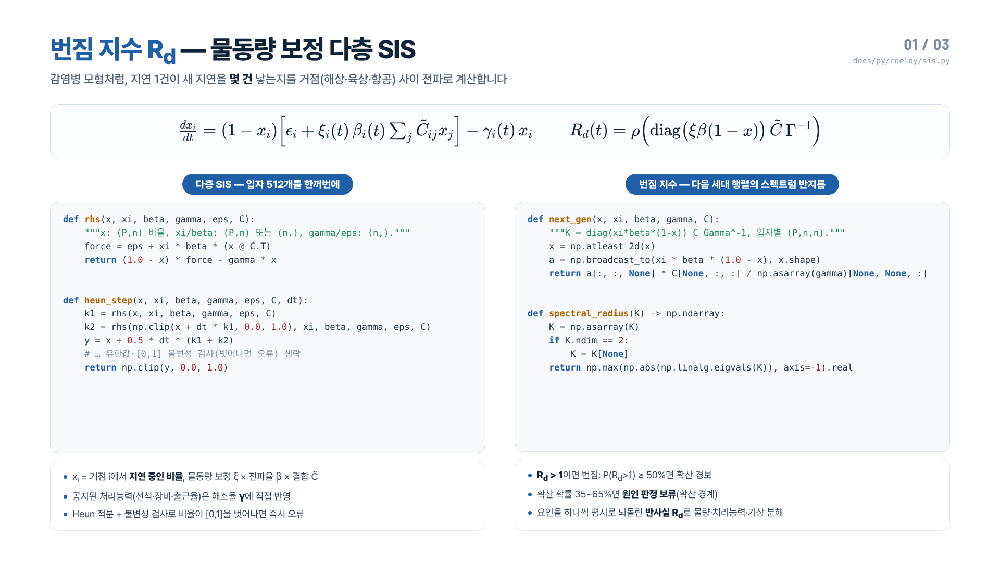

# R-Delay — 지연이 번지기 전에, 오늘 화물을 지킵니다
## 2026 동남권 멀티도메인 모빌리티 비즈니스 해커톤 출품작
#### 개인부문 · 해상–육상–항공 연쇄지연 조기경보와 배차 결정


---
### 개발 기간
- 기획·예선: 2026.10 (참가신청서·종합설계서, 합성 시제품)
- 본선판 v2.0: 2026.10 – 2026.11 (배차 담당자 화면·브리핑 4종·기사님 화면, 본선 시연용)

---

## 프로젝트 개요

R-Delay는 부산신항에서 시작된 지연이 게이트·도로를 거쳐 항공 반입까지 번지는 과정을 **감염병 확산 모형**으로 계산하는 배차 결정 도구입니다.
중소 운송사 배차 담당자가 오전 10시에 한 화면에서 **지연이 번지는지(번짐 지수 R<sub>d</sub>) → 왜 그런지 → 내 화물 중 무엇이 위험한지 → 몇 시에 출발해야 하는지**를 보고, 화주·기사·사내·항만에 보낼 안내문까지 바로 만듭니다.

**웹 데모 → https://jaewansh.github.io/R-Delay/** — 설치·가입 없이 PC·휴대폰 브라우저에서 바로 실행됩니다. 계산 엔진(Python)도 브라우저 안에서 돌아가고, 한 번 열면 인터넷이 끊겨도 열립니다.

| 배차 담당자 | 기사님 | 분석 화면 | 수리모형 | 실자료 검증 |
|:---:|:---:|:---:|:---:|:---:|
| [배차판·브리핑](https://jaewansh.github.io/R-Delay/?s=terminal_failure&c=ulsan_export) | [기사님 화면](https://jaewansh.github.io/R-Delay/driver.html?s=terminal_failure&c=ulsan_export&a=1) | [분석·근거](https://jaewansh.github.io/R-Delay/analysis.html?s=terminal_failure) | [작동 원리·검증](https://jaewansh.github.io/R-Delay/method.html) | [부산신항 2023~2026](https://jaewansh.github.io/R-Delay/backtest.html) |

> 상황판 장면은 합성 데이터 개념검증(TRL 3)입니다. 부산신항 2023~2026 공개 실자료로 되돌려 본 검증은 아래 [실자료 검증](#실자료-검증--부산신항-20232026-공개-자료-백테스트)에 따로 있습니다. 화면의 수치는 공개 보도로 확인한 사건 유형을 본뜬 가상 자료로 계산했으며, 특정 터미널·기업의 자료나 판정이 아닙니다(터미널 이름은 ‘가상 자동화 터미널 A’).

---

<!-- realdata-readme:start -->
### 실자료 검증 — 부산신항 2023~2026 공개 자료 백테스트

- PORT-MIS 관제정보로 잰 신항 컨테이너선 24,177항차(2023-01-01~2026-11-05)의 정박지 대기로 R-Delay를 되돌려 검증했습니다. 기간·목표·지표는 시험 기간을 보기 전에 [정했고](realdata/PROTOCOL.md), 시험 뒤 누설을 더 엄격하게 고친 1건이 있어 시험 기간을 두 번 계산했습니다(두 결과 모두 기록). 시험 기간(2025-07-01~2026-11-01) 8,256항차 중 12시간 넘게 기다린 배는 174척(기저율 2.1%)입니다.
- **도착 24시간 전, 예측 위험 상위 5% 선박에 실제 장기 대기의 38.5%가 들어 있었고, 경보 정밀도는 16.2%로 무작위의 7.7배였습니다**(상위 5%는 시험 기간 예측 분포 기준; 검증 기간에서 미리 정한 문턱으로는 경보 4.5%, 정밀도 17.4%, 재현율 37.4%). PR-AUC 0.193(95% 0.144~0.245, 무작위 0.021).
- 예측력은 주로 같은 선박의 이전 기항 이력, 같은 요일·시간대 슬롯 이력, 선박 크기(총톤수)에서 나왔습니다. 공개 자료만으로는 선석 대기열과 번짐 지수 R<sub>d</sub>가 하루 전 예측력을 거의 더하지 못했습니다. R-Delay 부품 없이 같은 이력 특징만 쓴 통계 GBM(PR-AUC 0.250)도 R-Delay GBM(0.234)과 같거나 높았습니다. 터미널 선석 계획(ETB) 연동이 다음 단계입니다.




- 자세히: [실자료 검증 화면](https://jaewansh.github.io/R-Delay/backtest.html) · [REPORT](REPORT.md#검증-실제-공개-자료-백테스트) · [전체 비교표](realdata/results/compare.md) · 재현 `python -m realdata.run_all`
<!-- realdata-readme:end -->

## 전체 개발 구조


## 시연 영상


---

## 핵심 기능


---

## 기술 스택

| 분야 | 기술 |
|------|------|
| Web App | HTML · CSS · JavaScript(빌드 없음), PWA(서비스 워커 오프라인 캐시·홈 화면 설치), SVG 차트 |
| Math Engine | Python — 물동량 보정 다층 SIS, 번짐 지수 R<sub>d</sub>, 입자필터·평활(음이항+베타-이항), 시간가변 선석 대기열(전진방정식), 기회제약 배차 |
| In-browser Runtime | Pyodide 0.27.2 · NumPy, Web Worker에서 실행(입력값 외부 전송 없음) |
| AI Module | 릿지 회귀 f<sub>ω</sub> — 풍속·파고·주말·장비 상태 → 전파율 사전평균(보조 모듈) |
| Briefing | 화주 안내 · 기사 지시 · 사내 보고 · 항만 협의 자동 작성, 복사·공유·인쇄·저장 |
| Data Kit | Python — PORT-MIS 관제정보 수집, ‘선박 대기 12시간 초과’ 라벨, 자료 점검표 |
| Real-data Backtest | Python(pandas·scikit-learn) — 누설 없는 2시간 판단 격자, 터미널별 선석 대기열 몬테카를로, 연속 입자필터(엔진과 같은 SIS 함수), 학습형 모듈, 주 단위 블록 부트스트랩 |
| Test | pytest 46개(엔진) + 실자료 단위·누설 테스트 9개(격자·선박 표·대기열·T1 예정 합계 누설 검사 포함), Node test 38개(화면 문구·브리핑 규칙), 합성 세계 60개 × 5개 장면 검증, 실자료 백테스트(시험 기간 고정), 화면 파일 버전 점검, 데이터 키트 자체 시험 20개 |
| Deploy | GitHub Pages (`/docs`), GitHub Actions (CI) |

---

## 주요 구현 코드




---

## 향후 구현 계획


> 위 1단계(공개 데이터로 실자료 백테스트)는 2026-11-07에 마쳤습니다. 결과는 위 [실자료 검증](#실자료-검증--부산신항-20232026-공개-자료-백테스트)과 [REPORT](REPORT.md#검증-실제-공개-자료-백테스트)에 있습니다.

---

## 실행 방법

<details>
<summary><b>웹 앱</b> (설치·빌드 없음)</summary>

```bash
python3 -m http.server -d docs 8000      # http://localhost:8000 에서 열기
```

- 장면과 화물은 주소로 고릅니다: `?s=<장면>&c=<화물>` (예: `?s=terminal_failure&c=ulsan_export`)
  - 장면: `base` · `terminal_failure` · `typhoon_diversion` · `holiday_surge` · `epidemic` · `h2_trucks`
  - 화물: `import_factory` · `ulsan_parts` · `sea_air` · `ulsan_export`
- 기사님 화면: `driver.html?s=terminal_failure&c=ulsan_export&a=1` (`a=1`은 시간 변경을 적용한 화면)
- 화면 파일(css·js)을 고치면 `docs/sw.js`의 `V`와 모든 `?v=` 값을 함께 올린 뒤 `node scripts/check-assets.mjs --write`를 실행합니다(오프라인 캐시가 옛 파일과 섞이지 않게).
- 올리는 방법과 GitHub Pages 설정은 [GUIDE_GITHUB.md](GUIDE_GITHUB.md)에 있습니다.

</details>

<details>
<summary><b>Python 엔진·검증</b> (Python 3.12 이상, Node.js 22 이상)</summary>

```bash
python3 -m pip install -r requirements.txt
python3 -m pytest -q                     # 엔진 테스트 46개
node --test tests/*.test.mjs             # 화면 문구·브리핑 규칙 테스트 38개
node scripts/check-assets.mjs            # 화면 파일 버전 점검
python3 scripts/train_ai.py              # 학습형 전파율 모듈 재학습(약 2분) → docs/data/ai_model.json
python3 scripts/build_data.py            # 6개 장면 미리 계산(약 4초) → docs/data/precomputed.json
python3 scripts/validate.py              # 합성 세계 검증(8코어 약 1분) → docs/data/validation.json
```

엔진만 쓸 때(브라우저와 같은 코드):

```python
import sys, json; sys.path.insert(0, "docs/py")
from rdelay import api
model = json.load(open("docs/data/ai_model.json"))
out = api.run({"scenario": "terminal_failure", "cargo": "ulsan_parts", "epsilon": 0.05}, ai_model=model)
print(out["now"]["alarm"], out["now"]["cause"], out["cargo"]["ulsan_parts"]["decision"]["message"])
```

시연 영상은 `scripts/demo/`에서 다시 만들 수 있습니다(Playwright·ffmpeg).

</details>

<details>
<summary><b>공개 데이터 수집 키트</b> (실자료 백테스트 준비)</summary>

```bash
cd data-kit
pip install -r requirements.txt
python selftest.py                       # 가짜 서버로 전 과정 시험(인터넷·인증키 불필요) → 20/20 통과
cp .env.example .env                     # 공공데이터포털 인증키 입력
python fetch_portmis.py --probe --start 2023-01-02 --end 2023-01-02   # 관제정보 제공 기간 확인
python run_all.py --start 2023-01-01     # 관제정보 수집 → 대기 라벨 → 점검표(하루 호출 한도마다 이어서)
```

화면별 단계 안내는 [data-kit/R-Delay_공개데이터_확보가이드.pdf](data-kit/R-Delay_공개데이터_확보가이드.pdf), Clarksons 자료 요청은 [data-kit/R-Delay_Clarksons_데이터요청서.pdf](data-kit/R-Delay_Clarksons_데이터요청서.pdf)에 있습니다. 받은 자료(`data-kit/data/`)와 인증키(`.env`)는 저장소에 올리지 않습니다.

</details>

<details>
<summary><b>실자료 백테스트</b> (부산신항 공개 자료, 원자료는 저장소 밖)</summary>

```bash
python3 -m pip install -r requirements-backtest.txt
echo "RDELAY_DATA_ROOT=/경로/RDelay_Data/Raw_data" > .env   # 그 아래 public_data/(derived·portmis·manual)
python3 -m realdata.run_all                # 캐시 → 판단 격자·선박 표 → 대기열 → SIS 필터 → 검증 → 시험 → 그림·docs/data/backtest.json
python3 -m realdata.run_all --relabel      # 새 관제정보를 넣었을 때 라벨부터 다시
```

설계는 [realdata/PROTOCOL.md](realdata/PROTOCOL.md)에 시험 전에 고정했고, 결과 표는 [realdata/results/compare.md](realdata/results/compare.md)에 있습니다. 원자료·캐시·Clarksons 자료는 저장소에 올리지 않습니다.

</details>

<details>
<summary><b>폴더 구조</b></summary>

```
R-Delay/
├─ docs/               GitHub Pages가 서비스하는 웹 앱 전체(빌드 없음)
│  ├─ index.html       배차 담당자 화면(배차판 + 브리핑 4종)
│  ├─ driver.html      기사님 화면
│  ├─ analysis.html    분석 화면(경보·원인·전망·검증 요약)
│  ├─ method.html      작동 원리·검증(수식·판정 규칙·검증 표)
│  ├─ assets/          화면 css·js, 글꼴(OFL), 아이콘
│  ├─ data/            미리 계산 결과 · AI 모듈 계수 · 검증 결과
│  ├─ py/rdelay/       Python 엔진: sis · volume · ai · engine · queue · cargo · stats · config · api
│  └─ sw.js            오프라인 캐시(서비스 워커)
├─ scripts/            학습 · 미리 계산 · 검증 · 화면 캡처 · 시연 영상(demo/)
├─ tests/              엔진(pytest) · 화면 문구·브리핑 규칙(node --test)
├─ data-kit/           공개 데이터 수집 키트 · 데이터 확보 가이드 · Clarksons 요청서
├─ realdata/           실자료 백테스트(프로토콜 · 코드 · 결과 표 · 그림). 원자료는 저장소 밖(RDELAY_DATA_ROOT)
├─ image/              README 이미지
├─ MODEL.md            모형 정의·가정·증명
├─ REPORT.md           기술 보고서(문제 · 시연 장면별 결과 · 합성 검증 · 로드맵 · 한계 · 출처)
├─ GUIDE_GITHUB.md     GitHub 업로드 · Pages 설정 · 확인 방법
└─ .github/workflows/ci.yml   테스트 자동 실행
```

</details>

## 데이터·인용 고지

- 화면의 물동량·처리능력·지연·비용·승인 확률·충전소 조건은 공개 보도로 확인한 사건 유형을 본뜬 **합성 가정치**입니다. 검증은 필터가 참 구조·정적 모수를 아는 조건의 합성 세계 결과이며 실증 성능이 아닙니다. 원인 판정은 모형상 배분이며 귀책 판단에 쓰지 않습니다. 의사결정 지원용이며 최종 판단과 책임은 사용자에게 있습니다.
- 브리핑 문서의 회사·담당자·연락처·컨테이너 번호(RDLU…)는 자리표시자·가상 값입니다.
- 문제 정의에 쓴 공개 보도와 지역 연계 근거는 [REPORT.md의 출처](REPORT.md#출처)에, 모형 상세는 [MODEL.md](MODEL.md)에 있습니다.
- 실자료 연동 시 출처: 해양수산부·부산항만공사 공공데이터(공공데이터포털), 기상청 기상자료개방포털(공공누리 출처표시), 한국도로공사. Clarksons Research 자료는 학술 이용 조건 때문에 원자료를 저장소에 넣지 않습니다.
- [P1] 선행연구 — *A mobility-informed SIR model for regional transmission dynamics: Evidence from subway mobility data in Korea, 2016–2023*(한국자료분석학회지 최종원고, 2026). 이동량 보정 계수 구조를 물동량·처리능력으로 옮겼습니다.
- 라이브러리·글꼴: [Pyodide](https://pyodide.org) 0.27.2(MPL-2.0), [NumPy](https://numpy.org)(BSD-3-Clause), [KaTeX](https://katex.org) 0.16.11(MIT), Pretendard·Barlow Semi Condensed(SIL OFL). 코드: [MIT License](LICENSE).

---

## 팀원

| 이름 | 이메일 |
|---|---|
|신재완|sjw6258@g.kmou.ac.kr|
|명정효|karl0126@naver.com|
|김진현|jinh7205@naver.com|
|김태훈|kth060420@gmail.com|
