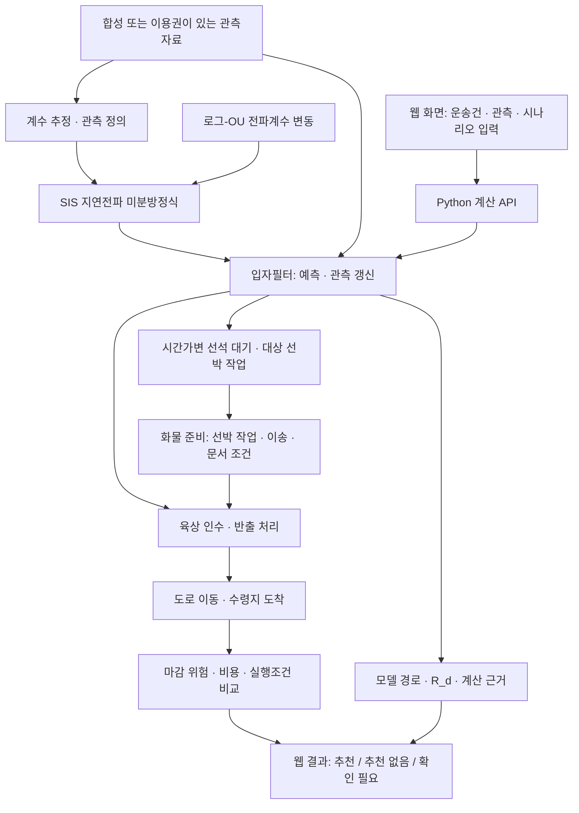

# R-Delay
## 감염병 확산 수리모델 기반 해상·육상 지연 예측·대응 웹서비스

**2026 동남권 멀티도메인 모빌리티 비즈니스 해커톤 · 개인부문 참가 준비 프로젝트**

> 해상에서 시작한 지연이 육상 운송에 어떤 영향을 주는지 계산하고, 원래 수령지 마감과 실행조건을 유지하면서 배차 유지·변경 후보를 비교하는 웹서비스를 목표로 합니다.
>
> **현재 상태: 제출·설계 문서 v0.1 및 문서 생성 코드. 웹서비스·수리모델 엔진·시연 영상은 아직 구현·검증되지 않았습니다.** 이 README의 구조도와 기능 설명은 구현 목표이며, 완성된 서비스 소개로 해석하면 안 됩니다.

[참가신청서 Word](deliverables/RDelay_참가신청서_v0.1.docx) · [종합설계 PDF](deliverables/RDelay_종합설계서_v0.1.pdf) · [신청서 PDF 미리보기](deliverables/RDelay_참가신청서_v0.1.pdf) · [구현 상태](docs/implementation_status.md)

---

## 1. 프로젝트 개요

R-Delay는 **수리모델을 실제 계산 엔진으로 사용하는 웹서비스**를 지향합니다. 수식 설명만 붙인 화면이나, 사전에 정한 숫자만 보여주는 대시보드로 대체하지 않습니다.

초기 적용 시나리오는 부산신항에서 양산권 내륙 수령지로 이동하는 수입컨테이너입니다. 내륙운송을 조율하는 운영담당자를 사용자 가설로 두며, 실제 고객·운송 연결자료·구매 의사는 아직 확보·검증하지 않았습니다.

| 사용자가 묻는 질문 | 구현할 기능 | 현재 상태 |
|---|---|---|
| 해상 지연이 육상으로 얼마나 전파되는가? | SIS 지연전파와 거점별 상태 추이 | 설계 / 미구현 |
| 새로운 관측이 들어오면 예측이 어떻게 바뀌는가? | 로그-OU 변동과 입자필터 갱신 | 설계 / 미구현 |
| 선석 대기가 화물 준비와 도착에 얼마나 영향을 주는가? | 시간가변 선석 대기와 사건별 시간 연결 | 설계 / 미구현 |
| 배차를 유지할까, 변경 요청할까? | 고정 마감·비용·예약·차량·변경 시한 비교 | 설계 / 미구현 |
| 왜 이 결과가 나왔는가? | 수식·입력·관측·모델 버전·제외 사유 조회 | 웹 구현 예정 |

모든 수리모델은 **이번 대회 구현 목표**입니다. 미구현 상태를 표시하는 것이 해당 기능을 대회 이후 연구로 제외한다는 뜻은 아닙니다.

## 2. 전체 개발 구조

**아래는 설계 구조도이며 실제 배포 구성도가 아닙니다.**



### 사건 정의

**선박 도착 → 선석 대기 → 선박 작업 → 화물 준비 완료 → 차량 인수·반출 → 도로 이동 → 수령지 도착**

SIS의 지연 작업 수와 선석 대기열의 선박 수는 같은 변수가 아닙니다. 화물 준비시각에 반영한 선석 대기를 최종 도착시간에 다시 더하지 않습니다. 원안에 없는 관측·준비·처리 연결식은 추가 가정으로 구분합니다.

## 3. 핵심 수리모델

사용자가 제공한 SIS 구조를 유지합니다.

$$
\frac{dI_i}{dt}=\beta_i(t)\left(1-\frac{I_i}{N_i}\right)\sum_j C_{ij}(t)I_j-\gamma_i(t)I_i.
$$

$$
C(t)=\mathrm{Id}+\kappa\tau_0 M(t).
$$

$$
R_d(t)=\rho\!\left[\operatorname{diag}\!\left(\beta_i(t)(1-I_i/N_i)\right)C(t)\Gamma(t)^{-1}\right].
$$

| 기호 | 뜻 · 단위 |
|---|---|
| `I_i`, `N_i` | 지연 상태·총 작업 수. 공통 의미의 작업단위를 정의해야 합니다. |
| `beta_i`, `gamma_i` | 전파율·지연 회복률, 시간⁻¹ |
| `M_ij` | 거점 `j → i` 연결 영향률, 시간⁻¹ |
| `tau_0`, `kappa`, `C_ij` | 기준시간, 무차원 연결 배율, 무차원 결합계수 |
| `Gamma`, `rho` | 회복률 대각행렬, 스펙트럼 반지름 |

**R_d는 개별 화물의 마감 실패확률이 아닙니다.** 단독 납기 안전기준으로 사용하지 않습니다. 로그-OU·필터·대기열·추정의 상세 수식과 가정은 [종합설계서](deliverables/RDelay_종합설계서_v0.1.pdf)에 있습니다.

## 4. 시연과 주요 화면

**실행 가능한 웹사이트 주소, 실제 앱 화면 캡처, 시연 영상은 아직 없습니다.** 문서 페이지나 가상의 목업을 실제 실행 화면으로 제시하지 않습니다.

첫 실제 시연의 완료 기준은 다음 흐름입니다.

> 합성 운송건 선택 → 실제 Python 엔진 계산 → 새 관측 반영 → 지연·대기·마감 위험 갱신 → 배차 후보 비교 → 계산 근거 저장

구현 후에는 다음 화면의 **실제 실행 캡처**와 시연 영상, 그 실행에 사용한 코드 버전을 이 절에 연결해야 합니다.

| 화면 | 확인할 내용 |
|---|---|
| 운송 상황 | 원래 마감, 자료 상태, 차량·예약·변경 조건 |
| 수리모델 분석 | SIS 상태, 로그-OU 경로, R_d와 계산 가정 |
| 관측 갱신 | 관측 전후 분포, 입자 가중치·ESS·경고 |
| 대기·대응 비교 | 대상 선박·화물 준비·도착, 후보별 위험·비용·제외 이유 |
| 계산 근거 | 입력·모델·코드 버전, 난수 설정, 결과 저장 |

## 5. 기술 스택과 구현 상태

| 영역 | 선택 또는 구현 목표 | 현재 확인된 상태 |
|---|---|---|
| 웹 | 웹 프론트엔드; React·TypeScript 구성 검토 | 서비스 소스 미등록 |
| API | FastAPI · Python | API 미구현 |
| 수리모델 | SIS, 로그-OU, 입자필터, 시간가변 대기열 | 설계만 존재 |
| 계수 추정 | 상수 계수 기준모형 및 외생변수 학습 | 실행 검증된 서비스 코드 없음 |
| 실행환경 | 같은 엔진의 온라인·로컬 실행 | 미구현·미배포 |
| 문서 제작 | Python, Pandoc, LibreOffice, PyMuPDF | 생성 원본·문서·실행 기록 존재 |
| 검사 | 문서 자동검사 / 모델·API·웹 검사 | 문서 검사만 수행; 전체 육안 검수 미완료 |

문서 생성 워크플로의 성공을 수리모델·웹 테스트 통과로 표시하지 않습니다. 실제 항만 예측력·구매 의사·비용 절감은 미검증입니다.

## 6. 저장소 구조와 주요 구현 코드

### 현재 실제로 존재하는 구조

```text
R-Delay/
├── README.md                 프로젝트 소개와 산출물 안내
├── AGENTS.md                 작업·개인정보·모델 보존 기준
├── deliverables/             참가신청서 Word, 설계서 PDF 및 묶음
├── docs/                     모델 명세·구현 상태·출처
├── scripts/                  문서 생성 코드
├── artifacts/                문서 검사 기록·페이지 렌더링
└── .github/                  문서 생성·검사 워크플로
```

현재 제공하는 실행 소스는 [문서 생성 코드](scripts/build_documents.py)입니다. **이를 수리모델 엔진의 최종 코드라고 부르지 않습니다.**

### 서비스 구현 시 추가할 구조 — 아직 존재하지 않는 계획

```text
web/                          실제 웹 화면과 API 호출
api/                          요청 검증·계산 실행·결과 반환
engine/
  sis.py                      원안 SIS와 R_d
  log_ou.py                   평균회귀를 포함한 로그-OU
  particle_filter.py          예측·관측 갱신·재표본추출
  observations.py             신규 사건 수 / 현재 지연 수 구분
  queue.py                    시간가변 선석 대기·대상 선박 추적
  cargo.py                    화물 준비·인수·반출·이동
  decision.py                 마감·비용·실행조건 비교
experiments/                  합성자료·계수 추정·시간순 평가
tests/                        수학·API·화면 연결 검사
data/synthetic/               공개 가능한 합성 샘플
deploy/                       온라인·로컬 실행 구성
```

빈 폴더나 `pass`만 있는 파일을 추가해 구현된 것처럼 보이게 하지 않습니다. 폴더 분리는 실제 계산과 실행 방법을 갖춘 코드로 채워질 때 완료로 판단합니다.

## 7. 실행 및 검증

**현재 서비스 실행 명령은 제공할 수 없습니다. 서비스 코드가 아직 없기 때문입니다.** 설치·실행·성능 검증을 하지 않은 명령이나 웹 주소를 만들어 적지 않습니다.

현재 문서 결과를 확인하려면 위 다운로드 링크를 이용하십시오. 문서 생성 과정은 [생성 원본](scripts/build_documents.py), [환경 기록](artifacts/environment_check.md), [문서 검사](artifacts/document_check.md), [전달 이력](artifacts/final_handoff.md)을 통해 확인할 수 있습니다.

서비스 완료 시에는 다음을 저장소에 포함해야 합니다.

1. 새 환경에서 재현한 설치·실행 명령과 필요한 버전.
2. 해석해·난수 재현·확률 보존·실행조건 검사 및 실제 로그.
3. 브라우저 입력이 API를 거쳐 동일 Python 엔진 결과를 표시하는 통합 검사.
4. 실제 실행 화면·시연영상과 해당 코드 버전.
5. 공개 배포 여부 및 인터넷 없는 로컬 계산 확인.

## 8. 참가·설계 자료

| 자료 | 링크 | 상태 |
|---|---|---|
| 참가신청서 Word | [DOCX](deliverables/RDelay_참가신청서_v0.1.docx) | v0.1, 개인정보 공란 |
| 참가신청서 배치 확인 | [PDF](deliverables/RDelay_참가신청서_v0.1.pdf) | 변환 기준 5쪽 |
| 종합설계서 | [PDF](deliverables/RDelay_종합설계서_v0.1.pdf) | 21쪽, 설계·구현 상태 구분 |
| 문서와 제작 원본 | [ZIP](deliverables/RDelay_v0.1_문서및생성원본.zip) | 서비스 소스 묶음 아님 |
| 상세 구현 명세 | [문서](docs/project_spec.md) | 원안과 추가 설계 가정 |
| 현재 상태 | [상태 기록](docs/implementation_status.md) | 모델·웹 미구현 명시 |

자동 문서 검사와 전 페이지 육안 검수는 다릅니다. 현재 육안 검수·Microsoft Word 자체의 배치 확인은 남아 있으며, 개인정보를 입력한 뒤 컨셉기획안 4쪽 제한을 다시 확인해야 합니다.

## 9. 개발 역할

개인정보와 팀원의 확정 여부를 임의로 적지 않습니다. 아래는 필요한 역할 정의입니다.

| 역할 | 담당 범위 |
|---|---|
| 수리모델·검증 | SIS·확률변동·필터·대기열과 수치검사 |
| 데이터·API | 관측 정의·정보 이용시점·계수 추정·API |
| 웹·시연 | 사용자 화면·실제 계산 연결·영상 |
| 도메인·사업화 | 공개 근거·사용자 행동·구매자 편익·제출문서 |

## 10. 공개·참고 원칙

저장소 구성의 참고 사례는 [Khyojae/DOCKin-Hackathon](https://github.com/Khyojae/DOCKin-Hackathon)입니다. 프로젝트 개요, 전체 개발 구조, 시연, 핵심 기능, 기술 스택, 주요 코드, 역할 분담을 함께 제시하는 형식을 참고했습니다. 해당 프로젝트의 앱 코드·화면 이미지·시연영상·수상 실적을 가져오거나 R-Delay의 성과로 사용하지 않습니다.

실제 운송자료·서명본·증명서·연락처·비밀키·폰트 파일은 공개하지 않습니다. 문서의 출처와 적용 범위는 `docs/`의 기록을 따릅니다.

`main` 병합, 저장소 공개범위 변경, 유료 서비스 결제, 외부 배포는 별도 승인 없이 실행하지 않습니다. 작업 브랜치에 저장한 자료를 기본 화면에 반영하는 검토용 PR과, 서비스 자체의 구현 완료를 구분합니다.
