# R-Delay — 지연이 번지기 전에, 오늘 화물을 지킵니다
## 2026 동남권 멀티도메인 모빌리티 비즈니스 해커톤 출품작
#### 개인부문 · 해상–육상–항공 연쇄지연 조기경보와 배차 결정

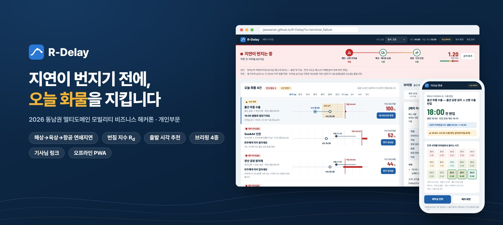

---
### 개발 기간
- 기획·예선: 2026.10 (참가신청서·종합설계서, 합성 시제품)
- 본선판 v2.0: 2026.10 – 2026.11 (배차 담당자 화면·브리핑 4종·기사님 화면, 본선 시연용)
- 실자료 백테스트: 2026.11 (부산신항 공개 자료로 되돌려 본 검증, 웹 ‘실자료 검증’ 화면 · 두 번째 분석 ‘선박별 검증’ 화면)

---

## 프로젝트 개요

R-Delay는 부산신항에서 시작된 지연이 게이트·도로를 거쳐 항공 반입까지 번지는 과정을 **감염병 확산 모형**으로 계산하는 배차 결정 도구입니다.
중소 운송사 배차 담당자가 오전 10시에 한 화면에서 **지연이 번지는지(번짐 지수 R<sub>d</sub>) → 왜 그런지 → 내 화물 중 무엇이 위험한지 → 몇 시에 출발해야 하는지**를 보고, 화주·기사·사내·항만에 보낼 안내문까지 바로 만듭니다.

**웹 데모 → https://jaewansh.github.io/R-Delay/** — 설치·가입 없이 PC·휴대폰 브라우저에서 바로 실행됩니다. 계산 엔진(Python)도 브라우저 안에서 돌아가고, 한 번 열면 인터넷이 끊겨도 열립니다.

| 배차 담당자 | 기사님 | 분석 화면 | 수리모형 | 실자료 검증 |
|:---:|:---:|:---:|:---:|:---:|
| [배차판·브리핑](https://jaewansh.github.io/R-Delay/?s=terminal_failure&c=ulsan_export) | [기사님 화면](https://jaewansh.github.io/R-Delay/driver.html?s=terminal_failure&c=ulsan_export&a=1) | [분석·근거](https://jaewansh.github.io/R-Delay/analysis.html?s=terminal_failure) | [작동 원리·검증](https://jaewansh.github.io/R-Delay/method.html) | [공개 자료 백테스트](https://jaewansh.github.io/R-Delay/backtest.html) |

> 합성 데이터 개념검증(TRL 3)입니다. 화면의 수치는 공개 보도로 확인한 사건 유형을 본뜬 가상 자료로 계산했으며, 특정 터미널·기업의 자료나 판정이 아닙니다(터미널 이름은 ‘가상 자동화 터미널 A’).
>
> **실제 공개 자료로 되돌려 본 결과**(공개 실자료 후향 검증, 실시간 운영 검증 아님): 평가 기간(2025-07-01 ~ 2026-10-29, 판단 시각 5,821개)에 ‘앞으로 24시간 안에 12시간 넘게 기다릴 컨테이너선이 오는가’를 맞힌 정도(PR-AUC)는 R-Delay 0.407, 지속성(지금 정박지 대기) 0.387, 기후값 0.291입니다. 기후값보다는 확실히 낫지만 지속성과는 차이가 없고, 대기 에피소드 81개 중 63개는 시작 전 72시간 안에 경보가 없었습니다. 앱의 확산 경보(P(R<sub>d</sub>&gt;1) ≥ 0.5)는 실자료에서 한 번도 울리지 않았고(P(R<sub>d</sub>&gt;1) 최대 0.0019), 스케줄 기준선에 R-Delay 상태를 더하면 확실히 나아집니다.
>
> → [실자료 검증 화면](https://jaewansh.github.io/R-Delay/backtest.html) · [비교표 `realdata/results/compare.md`](realdata/results/compare.md) · [기술 보고서의 해당 절](REPORT.md#검증-실제-공개-자료-백테스트)

<!-- realdata-ship-readme:start -->
> **선박별로 보면**(두 번째 분석, 선박 단위): 도착 24시간 전 위험 상위 5% 선박에 실제 12시간 초과 대기의 38.5%가 들었고, 경보 정밀도는 16.2%로 무작위(2.1%)의 7.7배였습니다(상위 5%는 시험 기간 예측 분포 기준, 미리 정한 문턱으로는 경보 4.5%·정밀도 17.4%·재현율 37.4%). 예측력은 주로 같은 선박의 이전 기항 이력, 같은 요일·시간대 슬롯 이력, 선박 크기(총톤수)에서 나왔고, 선석 대기열·번짐 지수가 더한 몫은 작았습니다. 대상 선박의 도착 시각과 터미널을 미리 안다는 낙관적 가정이 들어 있습니다.
>
> → [선박별 검증 화면](https://jaewansh.github.io/R-Delay/backtest-ship.html) · [비교표 `realdata_ship/results/compare.md`](realdata_ship/results/compare.md) · [기술 보고서의 해당 절](REPORT.md#두-번째-분석-선박별-하루-전-경보)
<!-- realdata-ship-readme:end -->

---

## 전체 개발 구조

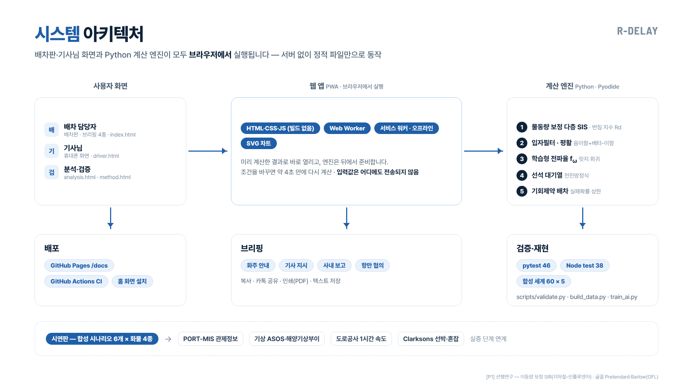

## 시연 영상

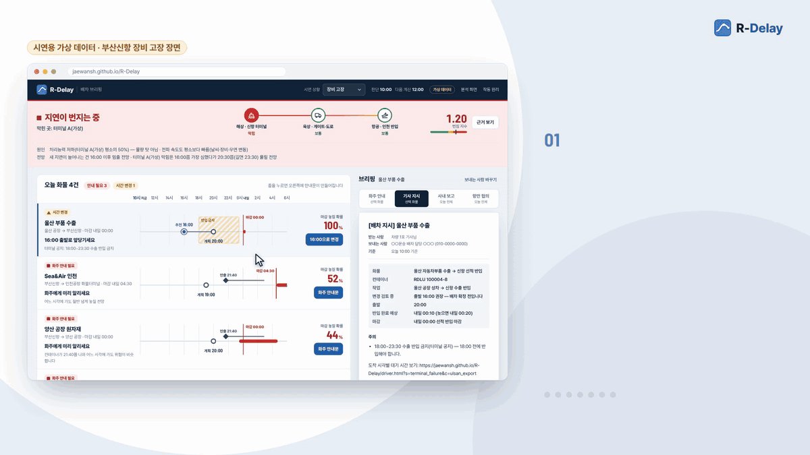

---

## 핵심 기능

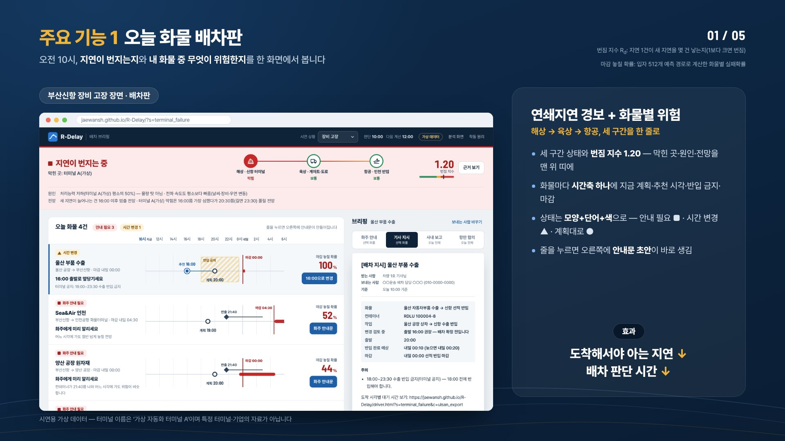
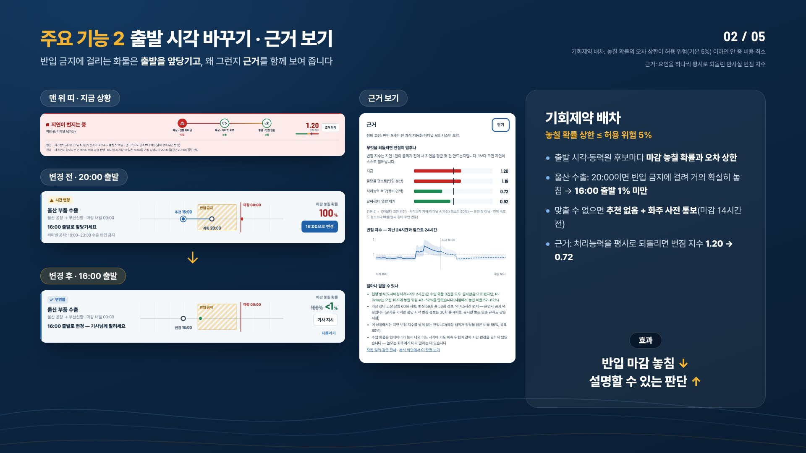
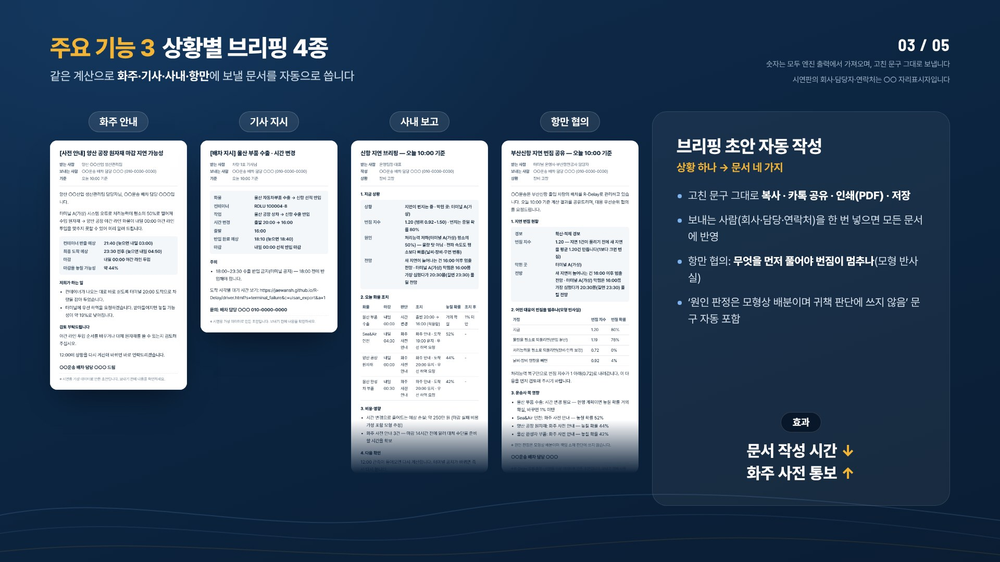
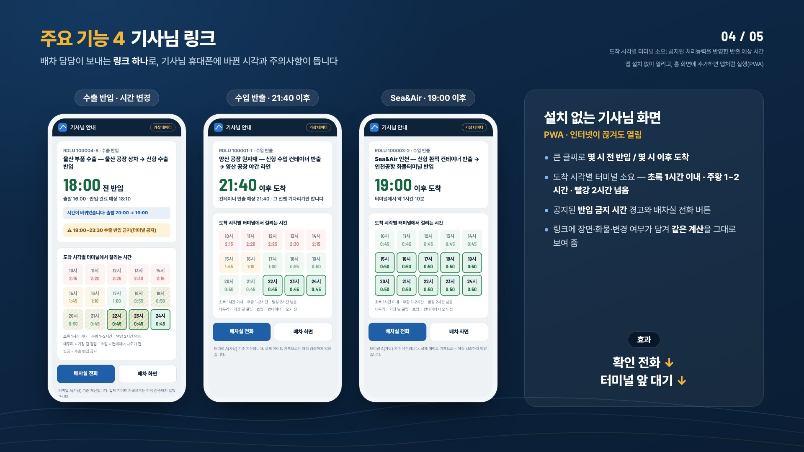
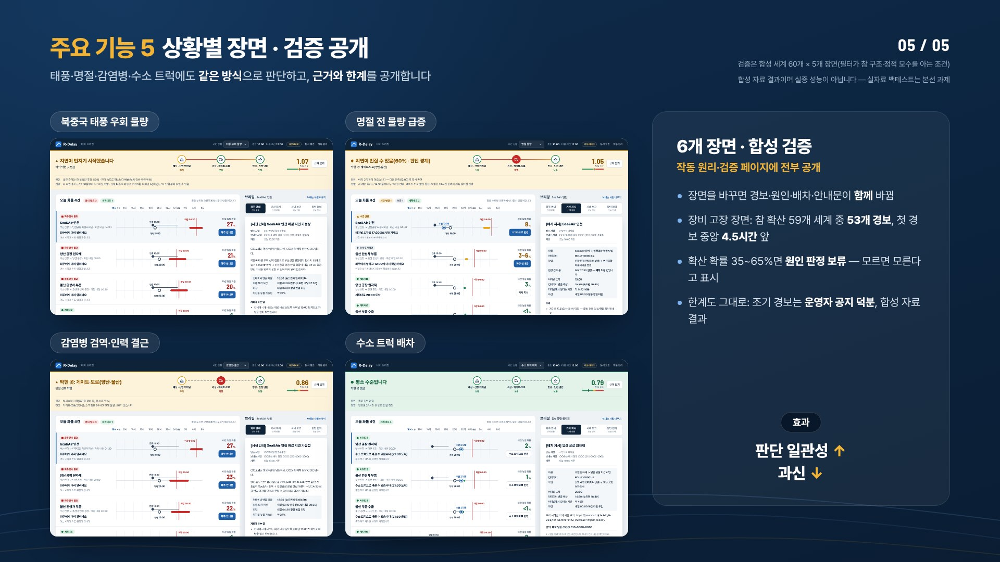

---

## 기술 스택

| 분야 | 기술 |
|------|------|
| Web App | HTML · CSS · JavaScript(빌드 없음), PWA(서비스 워커 오프라인 캐시·홈 화면 설치), SVG 차트 |
| Math Engine | Python — 물동량 보정 다층 SIS, 번짐 지수 R<sub>d</sub>, 입자필터·평활(음이항+베타-이항), 시간가변 선석 대기열(전진방정식), 기회제약 배차 |
| In-browser Runtime | Pyodide 0.27.2 · NumPy, Web Worker에서 실행(입력값 외부 전송 없음) |
| AI Module | 릿지 회귀 f<sub>ω</sub> — 풍속·파고·주말·장비 상태 → 전파율 사전평균(보조 모듈, 실자료 백테스트에서는 효과가 없어 끔) |
| Briefing | 화주 안내 · 기사 지시 · 사내 보고 · 항만 협의 자동 작성, 복사·공유·인쇄·저장 |
| Data Kit | Python — PORT-MIS 관제정보 수집, ‘선박 대기 12시간 초과’ 라벨, 자료 점검표 |
| Backtest | Python(pandas·scikit-learn·matplotlib) — 부산신항 공개 자료 후향 검증(`realdata/`): 기준선 S0~S3, 실자료 R-Delay(해상·육상 두 층), 평가 기간 1회 계산, 웹용 집계 `docs/data/backtest.json` · 두 번째 분석(`realdata_ship/`): 선박별 하루 전 경보(터미널별 선석 대기열 몬테카를로 + 하이브리드 로지스틱), `docs/data/backtest_ship.json` |
| Test | pytest 98개(엔진 46, 실자료 백테스트 43: 가짜 자료 단위 시험·결과 파일 확인·문서 숫자 확인·실자료 누설 검사, 선박 단위 9: 단위 시험·컷오프 누설 검사), Node test 56개(화면 문구·브리핑 규칙 38, 실자료 검증 화면 18), 합성 세계 60개 × 5개 장면 검증, 화면 파일 버전 점검, 데이터 키트 자체 시험 20개 |
| Deploy | GitHub Pages (`/docs`), GitHub Actions (CI) |

---

## 주요 구현 코드


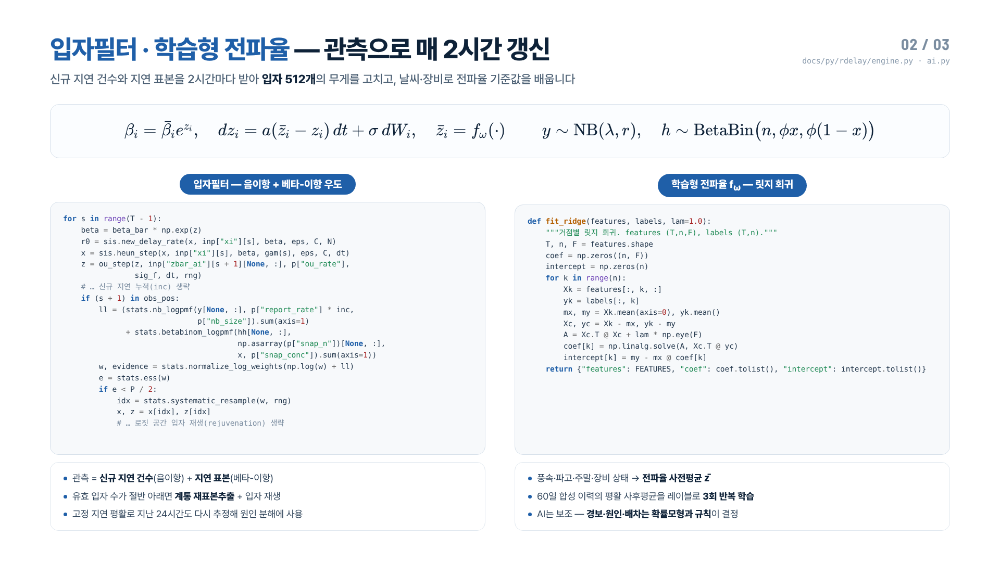
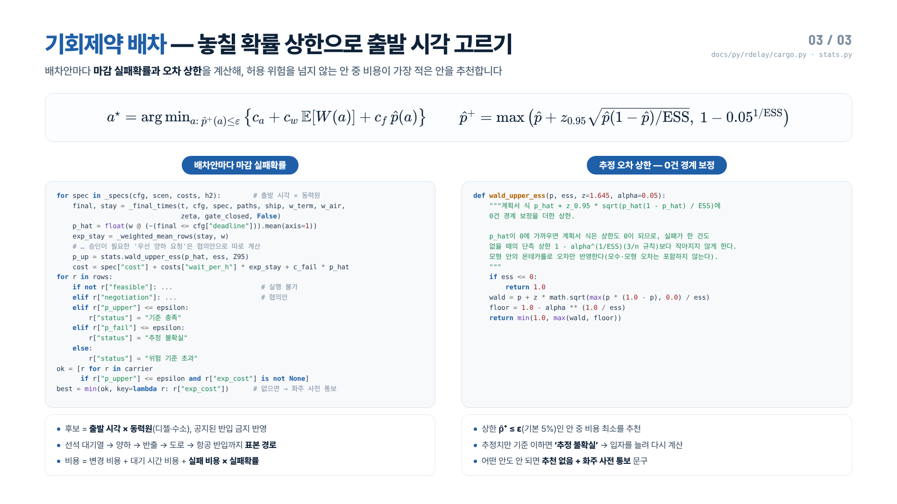

---

## 향후 구현 계획

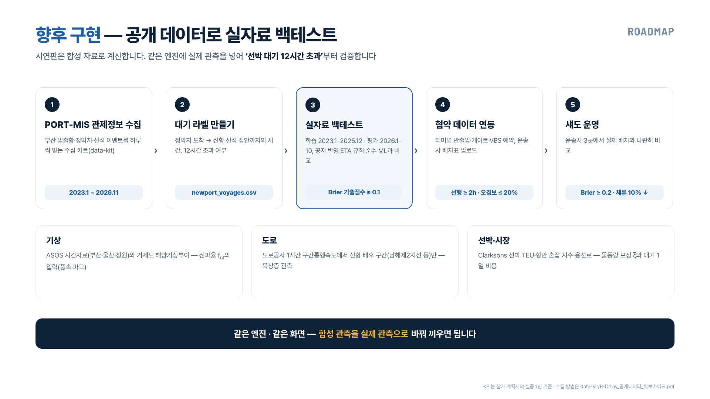

그림은 계획 당시의 로드맵입니다. ③ 실자료 백테스트는 공개 실자료 후향 검증(실시간 운영 검증 아님)으로 마쳤지만 계획과 다릅니다. 기간은 학습 2023-01-08 ~ 2024-12-31, 검증 2025-01-01 ~ 2025-06-30, 평가 기간 2025-07-01 ~ 2026-10-29로 나눴고, 공지 반영 ETA 규칙은 공개 자료에 도착 예정 신고 시각이 없어 비교하지 못했습니다(대신 기후값·지속성·스케줄 등 기준선과 비교, 기후값 대비 Brier 기술점수는 R-Delay 확률 0.063). 결과는 [실자료 검증](https://jaewansh.github.io/R-Delay/backtest.html)과 [REPORT](REPORT.md#검증-실제-공개-자료-백테스트)에 있습니다.

---

## 실행 방법

<details>
<summary><b>웹 앱</b> (설치·빌드 없음)</summary>

```bash
python3 -m http.server -d docs 8000      # http://localhost:8000 에서 열기
```

- 장면과 화물은 주소로 고릅니다: `?s=<장면>&c=<화물>` (예: `?s=terminal_failure&c=ulsan_export`)
  - 장면: `base` · `terminal_failure` · `typhoon_diversion` · `holiday_surge` · `epidemic` · `h2_trucks`
  - 화물: `import_factory` · `ulsan_parts` · `sea_air` · `ulsan_export`
- 기사님 화면: `driver.html?s=terminal_failure&c=ulsan_export&a=1` (`a=1`은 시간 변경을 적용한 화면)
- 화면 파일(css·js)을 고치면 `docs/sw.js`의 `V`와 모든 `?v=` 값을 함께 올린 뒤 `node scripts/check-assets.mjs --write`를 실행합니다(오프라인 캐시가 옛 파일과 섞이지 않게).
- 올리는 방법과 GitHub Pages 설정은 [GUIDE_GITHUB.md](GUIDE_GITHUB.md)에 있습니다.

</details>

<details>
<summary><b>Python 엔진·검증</b> (Python 3.12 이상, Node.js 22 이상)</summary>

```bash
python3 -m pip install -r requirements.txt
python3 -m pytest -q                     # 엔진 46개 + 백테스트 결과 파일·문서 숫자 확인 20개(실자료 백테스트 23개·선박 단위 9개는 requirements-backtest.txt 설치 시)
node --test tests/*.test.mjs             # 화면 문구·브리핑 규칙 38개 + 실자료 검증 화면 18개
node scripts/check-assets.mjs            # 화면 파일 버전 점검
python3 scripts/train_ai.py              # 학습형 전파율 모듈 재학습(약 2분) → docs/data/ai_model.json
python3 scripts/build_data.py            # 6개 장면 미리 계산(약 4초) → docs/data/precomputed.json
python3 scripts/validate.py              # 합성 세계 검증(8코어 약 1분) → docs/data/validation.json
```

엔진만 쓸 때(브라우저와 같은 코드):

```python
import sys, json; sys.path.insert(0, "docs/py")
from rdelay import api
model = json.load(open("docs/data/ai_model.json"))
out = api.run({"scenario": "terminal_failure", "cargo": "ulsan_parts", "epsilon": 0.05}, ai_model=model)
print(out["now"]["alarm"], out["now"]["cause"], out["cargo"]["ulsan_parts"]["decision"]["message"])
```

시연 영상은 `scripts/demo/`에서 다시 만들 수 있습니다(Playwright·ffmpeg).

</details>

<details>
<summary><b>공개 데이터 수집 키트</b> (실자료 백테스트 준비)</summary>

```bash
cd data-kit
pip install -r requirements.txt
python selftest.py                       # 가짜 서버로 전 과정 시험(인터넷·인증키 불필요) → 20/20 통과
cp .env.example .env                     # 공공데이터포털 인증키 입력
python fetch_portmis.py --probe --start 2023-01-02 --end 2023-01-02   # 관제정보 제공 기간 확인
python run_all.py --start 2023-01-01     # 관제정보 수집 → 대기 라벨 → 점검표(하루 호출 한도마다 이어서)
```

화면별 단계 안내는 [data-kit/R-Delay_공개데이터_확보가이드.pdf](data-kit/R-Delay_공개데이터_확보가이드.pdf), Clarksons 자료 요청은 [data-kit/R-Delay_Clarksons_데이터요청서.pdf](data-kit/R-Delay_Clarksons_데이터요청서.pdf)에 있습니다. 받은 자료(`data-kit/data/`)와 인증키(`.env`)는 저장소에 올리지 않습니다.

</details>

<details>
<summary><b>실자료 백테스트</b> (자료가 있을 때)</summary>

원자료는 저장소에 없습니다. 위 수집 키트와 확보 가이드로 받은 공개 자료 폴더(그 아래 `public_data/`에 `portmis/`·`derived/`·`manual/`)를 저장소 루트 `.env`에 `RDELAY_DATA_ROOT=<자료 폴더>`로 적은 뒤 차례로 실행합니다. 노트북(Windows·Mac)에서 처음 돌릴 때의 설치·점검 순서는 [RUN_LOCAL.md](RUN_LOCAL.md)에 있습니다(`python scripts/laptop_check.py`로 자료·패키지·글꼴 점검). 읽은 자료와 중간 결과는 `realdata/cache/`에 쌓이며 저장소에 올리지 않습니다. 검증 규칙과 변경 이력은 [realdata/PROTOCOL.md](realdata/PROTOCOL.md)에 있습니다.

```bash
python3 -m pip install -r requirements.txt -r requirements-backtest.txt
python3 -m realdata.io                               # 자료 읽기 → realdata/cache/
python3 -m realdata.audit                            # 자료 점검 → realdata/reports/data_audit.md, realdata/results/audit.json
python3 -m realdata.baselines                        # 기준선 S0~S3(학습·검증 기간) → realdata/results/baselines.json
python3 -m realdata.rdelay_real calibrate            # 실자료 모수 보정(학습 기간) → realdata/results/rdelay_params.json
python3 -m realdata.rdelay_real run --period all     # 판단 시각마다 R-Delay 실행 → realdata/cache/rdelay_all_W24_P512.parquet
python3 -m realdata.evaluate select --rdelay realdata/cache/rdelay_all_W24_P512.parquet   # 검증 기간에서 점수·설정 고르기
python3 -m realdata.evaluate final --rdelay realdata/cache/rdelay_all_W24_P512.parquet    # 평가 기간 1회 계산(기록이 있으면 멈춤)
python3 -m realdata.figures                          # 그림 → realdata/reports/fig_*.png
python3 -m realdata.report                           # 비교표 → realdata/results/compare.md
python3 -m realdata.cases                            # 사례 3개 → realdata/results/cases.json, realdata/reports/fig_case_*.png
python3 scripts/build_backtest.py                    # 웹용 집계 → docs/data/backtest.json
python3 -m realdata.run_all --dry-run                # 새 자료가 들어왔을 때: 무엇이 바뀔지만 보기
python3 -m realdata.run_all                          # 새 자료 반영을 한 번에(모형·설정 고정, 평가 기간만 늘리고 이유를 기록)
python3 -m realdata_ship.run_all                     # 두 번째 분석(선박 단위): 격자·선박 표 → 대기열 → SIS → 검증 → 시험 → 그림·backtest_ship.json·문서 절
python3 -m realdata_ship.run_all --relabel           # 새 관제정보가 들어왔을 때: data-kit 라벨부터 다시
```

- 평가 기간은 한 번만 계산합니다. 다시 계산하려면 `evaluate final`에 `--rerun-reason "이유"`를 붙여야 하고, 이유가 `realdata/results/test_runs.json`에 쌓입니다.
- 원자료 없이 저장소의 결과 파일만으로 웹용 집계를 확인하려면 `python3 scripts/build_backtest.py --check`(같으면 ‘backtest.json 일치’).
- f<sub>ω</sub> 실자료 재학습 기록(`realdata/results/ai_model_real.json`, 효과가 없어 끔)은 `python3 -m realdata.ai_real --rdelay realdata/cache/rdelay_all_W24_P512.parquet`로 다시 만듭니다.

</details>

<details>
<summary><b>폴더 구조</b></summary>

```
R-Delay/
├─ docs/               GitHub Pages가 서비스하는 웹 앱 전체(빌드 없음)
│  ├─ index.html       배차 담당자 화면(배차판 + 브리핑 4종)
│  ├─ driver.html      기사님 화면
│  ├─ analysis.html    분석 화면(경보·원인·전망·검증 요약)
│  ├─ method.html      작동 원리·검증(수식·판정 규칙·검증 표)
│  ├─ backtest.html    실자료 검증(부산신항 공개 자료 백테스트 결과)
│  ├─ backtest-ship.html  선박별 검증(두 번째 분석: 선박마다 도착 하루 전 경보)
│  ├─ assets/          화면 css·js, 글꼴(OFL), 아이콘
│  ├─ data/            미리 계산 결과 · AI 모듈 계수 · 검증 결과
│  │  ├─ backtest.json 실자료 백테스트 결과(부산신항 전체 집계 + 사례 3개 구간 그림 자료, scripts/build_backtest.py가 만듦)
│  │  └─ backtest_ship.json 선박별 검증 결과(리드별 지표·요인 제거 실험, realdata_ship이 만듦)
│  ├─ py/rdelay/       Python 엔진: sis · volume · ai · engine · queue · cargo · stats · config · api
│  └─ sw.js            오프라인 캐시(서비스 워커)
├─ realdata/           실자료 백테스트(검증 규칙 PROTOCOL.md · 코드 · 결과 집계 results/ · 그림 reports/), 원자료는 저장소에 없음
├─ realdata_ship/      두 번째 분석: 선박별 하루 전 경보(PROTOCOL.md · 코드 · results/ · reports/), 원자료는 저장소에 없음
├─ scripts/            학습 · 미리 계산 · 검증 · 화면 캡처 · 시연 영상(demo/)
│  ├─ build_backtest.py  실자료 결과(realdata/results) → docs/data/backtest.json
│  └─ laptop_check.py  내 컴퓨터에서 실자료 분석을 돌리기 전 점검(파이썬·패키지·자료·글꼴)
├─ tests/              엔진 · 실자료 백테스트 코드(가짜 자료) · backtest.json 점검(pytest) · 화면 문구·브리핑 규칙(node --test)
├─ data-kit/           공개 데이터 수집 키트 · 데이터 확보 가이드 · Clarksons 요청서
├─ image/              README 이미지
├─ MODEL.md            모형 정의·가정·증명
├─ REPORT.md           기술 보고서(문제 · 시연 장면별 결과 · 합성 검증 · 실자료 백테스트 · 로드맵 · 한계 · 출처)
├─ GUIDE_GITHUB.md     GitHub 업로드 · Pages 설정 · 확인 방법
├─ RUN_LOCAL.md        내 컴퓨터(Windows·Mac)에서 실자료 분석 실행하기
└─ .github/workflows/ci.yml   테스트 자동 실행
```

</details>

## 데이터·인용 고지

- 화면의 물동량·처리능력·지연·비용·승인 확률·충전소 조건은 공개 보도로 확인한 사건 유형을 본뜬 **합성 가정치**입니다. ‘작동 원리·검증’의 검증 표는 필터가 참 구조·정적 모수를 아는 조건의 합성 세계 결과이며 실증 성능이 아닙니다. 실제 공개 자료로 되돌려 본 결과는 [실자료 검증](https://jaewansh.github.io/R-Delay/backtest.html)에 따로 있으며, 공개 실자료 후향 검증(실시간 운영 검증 아님)이고 해상·육상 두 층만 썼습니다(항공 자료 없음). 원인 판정은 모형상 배분이며 귀책 판단에 쓰지 않습니다. 의사결정 지원용이며 최종 판단과 책임은 사용자에게 있습니다.
- 브리핑 문서의 회사·담당자·연락처·컨테이너 번호(RDLU…)는 자리표시자·가상 값입니다.
- 문제 정의에 쓴 공개 보도와 지역 연계 근거는 [REPORT.md의 출처](REPORT.md#출처)에, 모형 상세는 [MODEL.md](MODEL.md)에 있습니다.
- 실자료 백테스트와 자료 점검에 쓴 공개 자료: 해양수산부 PORT-MIS 관제정보·선박운항정보, 부산항만공사 집계, 해양수산부 수출입 물류 플랫폼(이상 공공데이터포털), 기상청 ASOS·해양기상부이(기상자료개방포털)와 태풍경로(공공데이터포털)(기상청 자료는 공공누리 출처표시), 한국도로공사 구간통행속도(고속도로 공공데이터 포털). 데이터 ID와 링크는 [REPORT.md의 출처](REPORT.md#출처)에 있습니다. 원자료와 전체 기간의 가공 자료는 저장소에 넣지 않았습니다. 공개 결과는 부산신항 전체 집계값이고, 사례 그림 3개 구간에 한해 2시간 간격 그림 자료와 12시간 넘게 기다린 배의 도착 시각(시 단위로 내림)·대기 구간(12~24·24~48·48~168시간)을 담았습니다([공개 범위](REPORT.md#자료와-정답)). 선박 이름·호출부호·터미널은 넣지 않습니다. Clarksons Research 자료는 학술 이용 조건 때문에 원자료를 저장소에 넣지 않습니다.
- [P1] 선행연구 — *A mobility-informed SIR model for regional transmission dynamics: Evidence from subway mobility data in Korea, 2016–2023*(한국자료분석학회지 최종원고, 2026). 이동량 보정 계수 구조를 물동량·처리능력으로 옮겼습니다.
- 라이브러리·글꼴: [Pyodide](https://pyodide.org) 0.27.2(MPL-2.0), [NumPy](https://numpy.org)(BSD-3-Clause), [KaTeX](https://katex.org) 0.16.11(MIT), Pretendard·Barlow Semi Condensed(SIL OFL). 코드: [MIT License](LICENSE).

---

## 팀원

| 이름 | 이메일 |
|---|---|
|신재완|sjw6258@g.kmou.ac.kr|
|명정효|karl0126@naver.com|
|김진현|jinh7205@naver.com|
|김태훈|kth060420@gmail.com|
