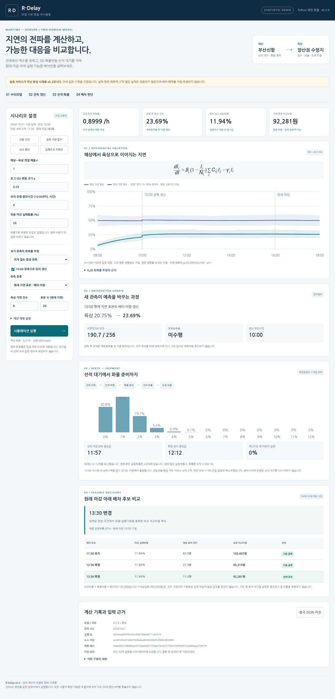
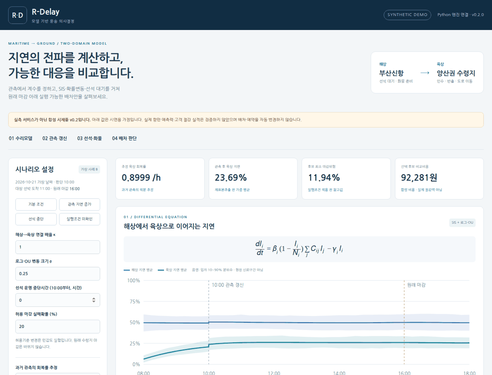
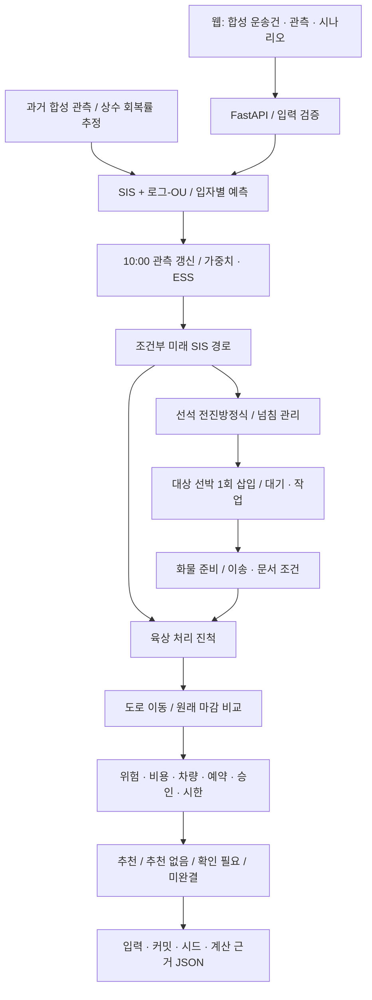

# R-Delay
### 감염병 확산 수리모델 기반 해상·육상 지연 예측·대응 웹서비스

**2026 동남권 멀티도메인 모빌리티 비즈니스 해커톤 · 개인부문 참가 준비 프로젝트**

> 수식 설명만 보여주는 화면이 아닙니다. 브라우저의 입력을 실제 Python 계산 엔진에 전달하고, **계수 추정 → SIS·로그-OU → 관측 갱신 → 선석 대기 → 화물 준비·반출 → 배차 위험·비용**을 계산하는 합성 시제품입니다.
>
> **v0.2 범위:** 2거점, 10:00 관측 1회, 합성자료 전용 로컬 웹서비스. 실제 항만 예측력·고객 구매·절감 효과는 미검증입니다. 외생변수 머신러닝·일반 관측 스트리밍·공개 배포는 아직 없습니다. 검사 통과 여부는 아래 **실제 실행 기록**에서 확인하세요. 테스트 소스 존재만으로 통과를 주장하지 않습니다.

[실행 코드 ZIP](deliverables/RDelay_runtime_v0.2.zip) · [실행 검증 기록](artifacts/runtime/validation_summary.md) · [신청서 Word](deliverables/RDelay_참가신청서_v0.1.docx) · [종합설계 PDF](deliverables/RDelay_종합설계서_v0.1.pdf) · [구현 계약·한계](docs/runtime_contract.md)

작업 브랜치: **`codex/rdelay-bootstrap`**. 기본 `main`에 자동 병합하지 않았습니다. 기본 저장소 첫 화면에서는 아직 이 결과가 보이지 않을 수 있습니다. [PR #1](https://github.com/jaewansh/R-Delay/pull/1)에서 검토할 수 있습니다.

---

## 1. 문제와 프로젝트

해상 지연이 육상 일정에 전파될 때, 운송 조율 담당자가 **원래 수령 마감과 실제 변경조건을 함께 보며** 배차 유지·변경을 검토하는 서비스를 지향합니다. 부산신항→양산권 수입컨테이너를 초기 업무 시나리오로 설정했습니다. 해당 구간의 실제 연결자료나 고객을 확보했다는 의미는 아닙니다.

이번 실행 사례 B는 **가상 08:00 시작 / 10:00 판단 / 대상 선박 11:00 도착 / 원래 수령지 마감16:00**입니다. 과거 대화의 다섯 상태·13:15 예제와 다른 합성 시나리오입니다. 후보를 비교하는 동안 원래16:00 마감을 바꾸지 않습니다.

## 2. 실제 실행 화면과 시연

아래 PNG·GIF·WebM은 `scripts/check_runtime_browser.py`가 **실제 로컬 API와 Chromium**을 실행해 저장하는 자료입니다. API 답변을 모킹하거나 목업 이미지를 만들지 않습니다. 생성 여부와 통과 기록은 [browser_check.json](artifacts/runtime/browser_check.json)을 기준으로 합니다. 이미지를 직접 눈으로 검토한 여부는 별도 기록입니다.



### 기본 조건 → 관측 지연 증가 → 선석 운영 중단



[브라우저 녹화 WebM](image/runtime/demo.webm) · [관측 갱신 화면](image/runtime/posterior.png) · [운영 중단 화면](image/runtime/closure.png) · [모바일 폭 화면](image/runtime/mobile.png)

**공개 웹사이트 URL은 아직 없습니다.** 저장소 업로드·로컬 서버 실행·공개 배포는 서로 다른 작업입니다. 노트북에서는 아래 명령으로 웹사이트를 실행합니다.

## 3. 빠른 실행

Python 3.12 환경을 권장합니다. 첫 설치에는 패키지 다운로드가 필요합니다. 설치 후에는 외부 항만 서버·지도·CDN 없이 동일 컴퓨터에서 계산합니다.

```bash
git clone --branch codex/rdelay-bootstrap --single-branch https://github.com/jaewansh/R-Delay.git
cd R-Delay
python3 -m venv .venv
source .venv/bin/activate
python -m pip install -r requirements-service.txt
python -m uvicorn api.main:app --host 127.0.0.1 --port 8000
```

Windows에서는 가상환경 활성화 명령을 `.venv\Scripts\Activate.ps1`로 바꿉니다. 브라우저에서 **http://127.0.0.1:8000**에 접속합니다. HTML 파일을 더블클릭하는 방식은 Python 엔진을 실행하지 못합니다.

실행 후 `시뮬레이션 실행`을 누르면 실제 계산이 돌아옵니다. 관측 건수·연결 배율·확률변동·선석 중단시간을 바꾸고 다시 실행하세요. 원래 마감은 고정입니다. 새 입력이나 계산 오류가 있으면 이전 추천을 숨깁니다.

### 선택: 로컬 컨테이너

```bash
docker compose up --build
```

컨테이너 설정은 포함했지만 실행 검증 여부는 [검증 기록](artifacts/runtime/validation_summary.json)을 확인하세요. 호스트 포트는127.0.0.1에만 연결합니다. Docker 이미지를 외부에 게시하거나 유료 서버를 만들지 않았습니다.

## 4. 실제 소스 구조

```text
engine/
  sis.py                 원안 SIS, 집단 크기 비율, 입자별 R_d
  filtering.py           로그-OU, 베타-이항·음이항, 가중치·ESS·재표본추출
  queueing.py            시간가변 선석 전진방정식·흡수 넘침·대상 선박
  calibration.py         관측 적분에 의한 상수 회복률 추정·합성 평가
  simulation.py          사건 연결·고정 마감·비용·실행조건의 전체 계산
api/
  schemas.py             입력·시각·자료상태·계산 크기 제한
  main.py                계산 API와 로컬 웹, 결과 JSON 저장
web/
  index.html             운영 화면과 실제 수리모델 식
  styles.css             데스크톱·모바일 레이아웃
  app.js                 입력·API 호출·결과 시각화 (모델 재구현 없음)
tests/                    수리모델·제약·API·직접 검산
scripts/                  실제 브라우저 검사·증거 패키징 / 기존 문서 생성
artifacts/runtime/        실행한 pytest·Chromium 검사·예시 결과
image/runtime/            실제 화면 PNG·시연 GIF·브라우저 녹화
├ deliverables/           Word·PDF v0.1, 서비스 소스 ZIP v0.2
├ docs/                   설계·출처·구현 계약·상태
└ .github/workflows/      문서 검사 / 서비스 CI 분리
```

[수리모델 원본](engine/) · [API](api/) · [웹](web/) · [테스트](tests/) · [실제 브라우저 검사](scripts/check_runtime_browser.py)

## 5. 전체 계산 구조



실제 소스에 대응하는 로컬 실행 구조입니다. 공개 배포 구성도가 아닙니다.

## 6. 핵심 미분방정식

$$
\frac{dI_i}{dt}=\beta_i(t)\left(1-\frac{I_i}{N_i}\right)\sum_j C_{ij}(t)I_j-\gamma_i(t)I_i.
$$

$$
C(t)=\mathrm{Id}+\kappa\tau_0M(t),\qquad R_d(t)=\rho\left[\operatorname{diag}\left(\beta_i(t)(1-I_i/N_i)\right)C(t)\Gamma(t)^{-1}\right].
$$

시간은h, I/N은같은 의미의 작업 수/비율, beta/gamma/M은h^-1, C의 행은 받는 거점·열은 보내는 거점입니다. **R_d는 개별 화물의 실패확률이 아닙니다.** SIS 상태는 선석 대기열의 선박 수와도 다릅니다.

로그-OU는 평균회귀하는 로그 상태에서 양의 beta를 만듭니다. 필터는 신규 사건 수에 음이항, 현재 표본 지연 수에 베타-이항을 사용합니다. 관측 종류에 맞는 가능도를 계산하고, 원래 모델의 설명과 새 관측 연결 가정을 구분합니다.

**추가 가정:** SIS 해상 지연은 선석 서비스 위험률에, 육상 지연은 반출 처리속도에 연결됩니다. 대상 선박 작업 이후 이송·문서 조건으로 준비시각을 정합니다. 선석 대기는 여기 한 번만 반영합니다. 자세한 조건과 한계는 [runtime_contract.md](docs/runtime_contract.md)에 있습니다.

## 7. 핵심 기능과 검증

| 기능 | 실제 코드 | 확인 방법 |
|---|---|---|
| SIS 지연전파 | `engine/sis.py` | 해석해·상태 범위·다른 집단 크기 검사 |
| 로그-OU 확률변동 | `engine/filtering.py` | 전이 평균·분산·무잡음·고정 시드 검사 |
| 관측 갱신 | `engine/filtering.py` | 두 입자 직접 계산·불가능 관측·ESS |
| 선석 대기 | `engine/queueing.py` | 순수 도착 Poisson 대조·확률 보존·넘침 |
| 화물·육상 연결 | `engine/simulation.py` | 사건 순서·중복 대기 방지·기간 밖 표본 |
| 계수 추정 | `engine/calibration.py` | 상수 회복률 복원·잡음 민감도; 머신러닝 전체 아님 |
| 배차 의사결정 | `engine/simulation.py` | 고정 마감·시간 경계·미확인 후보 제외 |
| 웹/API | `api/`, `web/` | 실제 Chromium 입력·갱신·저장·오류·모바일 검사 |

```bash
python -m pip install -r requirements-test.txt
python -m pytest tests -q
python -m playwright install chromium
PYTHONPATH=. python scripts/check_runtime_browser.py
```

Linux에 브라우저 시스템 의존성이 없으면 `python -m playwright install --with-deps chromium`으로 준비합니다. 검사 기록은 [validation_summary.md](artifacts/runtime/validation_summary.md)와 [browser_check.json](artifacts/runtime/browser_check.json)에 있습니다. 문서 생성 워크플로 성공을 서비스 검사 통과로 바꾸어 표시하지 않습니다.

## 8. 구현 범위와 아직 남은 일

합성 시제품은 실제 계산을 연결했지만 실제 데이터 학습 서비스는 아닙니다. v0.2는 **10:00에 이용 가능한 관측1회**와 알려진 초기 대기열만 지원합니다. 같은 시각의 관측 수정은 원본 실행을 보존하고 새 실행으로 만듭니다. 늦게 수신한 관측·임의 시간의 스트리밍은 거부합니다.

외생변수 기반 beta/gamma 머신러닝, 일반 관측 스트리밍, 실제 연결자료, 여러 운송건 공동 최적화, 공개 배포·인증·영속 저장은 아직 구현하지 않았습니다. 이번 대회 목표에서 임의로 제외한 것은 아닙니다.

과거 문서 v0.1은 설계 스냅샷으로 보존했습니다. 서비스 구현 후 제출 문서의 상태표를 갱신하는 작업은 별도이며, 문서의 전체 육안 검수도 여전히 별개입니다. 위험값을 실제 실패율·비용 절감 실적으로 쓰지 않습니다.

## 9. 제출 자료와 역할

[참가신청서 Word](deliverables/RDelay_참가신청서_v0.1.docx) · [신청서 PDF](deliverables/RDelay_참가신청서_v0.1.pdf) · [21쪽 종합설계서](deliverables/RDelay_종합설계서_v0.1.pdf) · [문서 생성 원본](scripts/build_documents.py)

역할은 수리모델·검증, 데이터·관측 정의, 웹·사용자 흐름, 공개 업무근거·사업화로 분담합니다. 팀원 이름·개인정보·서명·증명서는 공개하지 않습니다. 비용 부담자·구매자·가격은 아직 가설입니다.

구성 참고: [DOCKin-Hackathon](https://github.com/Khyojae/DOCKin-Hackathon)의 프로젝트 소개·역할별 코드·실제 시연 구조. 타 프로젝트의 코드·이미지·영상·수상 이력은 가져오지 않았습니다. 라이선스가 확인되지 않은 코드를 복사하지 않습니다. 수리모델은 사용자 제공 원안과 명시한 후속 설계입니다.
